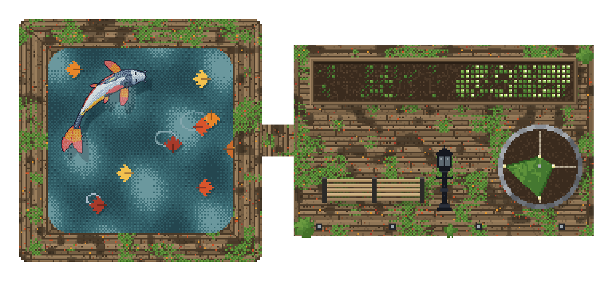

<h1 align="center">Yafet Beyene</h1>

Performance engineering and applied AI · Building

  <picture>
    <source media="(max-width: 700px) and (prefers-color-scheme: dark)" srcset="koi/koi-pond-night.gif" />
    <source media="(max-width: 700px)" srcset="koi/koi-pond.gif" />
    <source media="(prefers-color-scheme: dark)" srcset="koi/koi-night.gif" />
    
  </picture>

### Contact

[yafet.a.beyene@gmail.com](mailto:yafet.a.beyene@gmail.com) · [LinkedIn](https://www.linkedin.com/in/yafetbeyene/)
